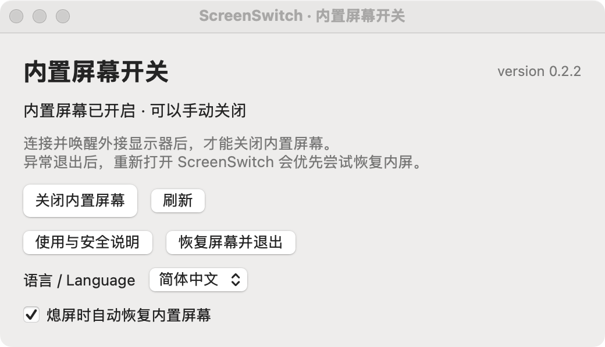

# ScreenSwitch

[简体中文](README.md) | **English**

Keep your MacBook open and work on an external monitor while continuing to use the built-in keyboard and trackpad.

A simple switch attempts to disable the built-in display's desktop output—not just dim it or cover it with a black window. A control window and Dock entry keep the app accessible even when the menu bar is full. **The UI supports Simplified Chinese and English, defaulting to Chinese.**



*Actual v0.2.2 screenshot: a state-aware display action, read-only Refresh, and live language switching.*

> **Experimental:** ScreenSwitch uses an unsupported macOS interface. Compatibility and recovery are not guaranteed. Build, UI, and simulated checks have passed, but this does not establish compatibility with every machine. Read the recovery steps before first use.

## Download and install

Download **ScreenSwitch-v0.2.2-macos-arm64.zip** from [Releases](https://github.com/haroldvandy2013/ScreenSwitch/releases/latest). Extract it and copy **ScreenSwitch.app** to your Applications folder. Disabling and recovery are integrated into this single app; no separate restore app is needed.

Before updating, confirm that the built-in display is active, then quit the old version and replace it. Do not force-quit a stuck old version while the built-in display is off.

When upgrading from v0.1.0, quit the old app normally before replacing it. Once you confirm that the new app restores the panel on normal quit, you may remove the old `恢复内置屏幕.app`.

The download is for **Apple Silicon Macs running macOS 13 or later**. Development used an M3 Max on macOS 15.8.1; this is not a claim of verified display-control compatibility.

The app is **not Apple-notarized**. If launch is blocked, try Finder's right-click → Open or Open Anyway in System Settings. **Do not disable system security protections.**

## Use

1. Keep the lid open. Connect and wake an external monitor, and confirm that it displays a usable desktop.
2. Open ScreenSwitch, click **关闭内置屏幕** (“Turn off built-in display”), read the warning, and confirm. The action is unavailable without a usable external display.
3. Click **恢复内置屏幕** (“Restore built-in display”) when you want the panel back.

Use **语言 / Language** in the window or menu to select “简体中文” or “English”. Changes apply immediately and are remembered. A fresh installation defaults to Chinese.

The version appears in the top-right corner. **Refresh** only rechecks display state, without disabling or restoring a display. The single action reads “Turn off built-in display” while the panel is on, and “Restore built-in display” while it is off. An already active panel does not receive redundant restore transactions.

The source and local fix are **v0.2.4** (the download remains v0.2.2): automatic recovery requires an existing recovery record or this process's manual-disable intent. Temporary inactivity during normal display sleep, system sleep or wake does not count as an app-issued disable. Recovery intent is cleared only after observations show an active internal display with unchanged display configuration for at least two seconds, rather than after one transient active reading.

**Optional: Restore built-in display on screen sleep.** Unchecked by default. When enabled, display sleep triggers an attempt to restore the panel disabled by this app; the choice is remembered. This means actual display sleep, not just locking the screen or starting a screensaver. It does not reboot the Mac or send wake commands; screen illumination depends on macOS. Waking never automatically disables the panel again.

The app attempts restoration when the last usable external display disconnects, before sleep, and on normal quit. Reconnecting a monitor or waking the Mac **never automatically disables the panel**.

System-sleep, unplug and quit recovery remain enabled regardless of the screen-sleep option.

Removal of the last external monitor requests immediate restoration, with continued active-state checks. If normal recovery fails with no external monitor available, the app also requests macOS's saved display configuration. **This may reset display arrangements.** Restoration is still not guaranteed on every machine or after driver failures.
Closing the window keeps the app running. Clicking its Dock icon or reopening the app first attempts restoration if recovery is pending. If no record exists but recovery is needed, click **Refresh** and manually select **Restore built-in display**. Quit using **恢复屏幕并退出** (“Restore and quit”), rather than force-quitting.

## If the screen goes black

Before first use, locate ScreenSwitch. If you plan to find it through Spotlight, confirm that Spotlight has indexed it in advance.

1. Reconnect and wake the external monitor, then try **恢复内置屏幕**.
2. Reopen **ScreenSwitch.app**, directly or through Spotlight, to attempt recovery first. Reopening may not help if the process is hung; continue to the next step.
3. Try closing and reopening the lid. If recovery still fails, restart the Mac, keeping unsaved work in mind.

**Automatic recovery is not guaranteed after a crash, force quit, or system failure.** For the first attempt, use a directly connected physical monitor—not a virtual display or remote desktop as your only fallback. Avoid running other display-disabling utilities at the same time. Stop trying if disabling or restoration fails.

### Diagnostic logs

Starting with v0.2.4, macOS's local unified log records display-state changes, display callbacks, sleep/wake, recovery reasons, record writes/removals, and display-API return codes. Screen contents are not recorded and logs are not uploaded. If an issue recurs, note the time and whether you have reconnected the external monitor; keep the app running. **Copy read-only diagnostics** in the menu captures current state. Export the last day's events from Terminal:

```bash
/usr/bin/log show --last 1d --style compact --predicate 'subsystem == "local.ScreenSwitch"' > ~/Desktop/ScreenSwitch.log
```

macOS controls retention. A healthy current state does not establish what happened during the incident.

<details>
<summary>Build from source</summary>

Requires Swift 6.0 or later and Xcode Command Line Tools.

```bash
git clone https://github.com/haroldvandy2013/ScreenSwitch.git
cd ScreenSwitch
./build.sh
```

Only `dist/ScreenSwitch.app` is generated, using the host Mac's processor architecture. You can also run `./dist/ScreenSwitch.app/Contents/MacOS/ScreenSwitch --restore` from Terminal to attempt restoration only, without disabling the panel.

</details>
