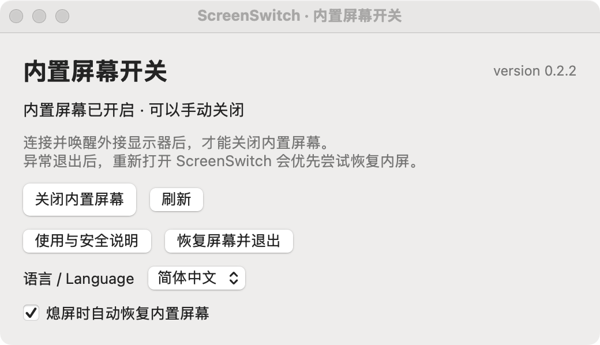

# ScreenSwitch · 内置屏幕开关

**简体中文** | [English](README.en.md)

让 MacBook 保持开盖，只用外接显示器工作，同时继续使用内置键盘和触摸板。

通过一个简单开关尝试真正停用内屏桌面输出，而不是把亮度调为零或盖上黑色窗口。提供控制窗口、Dock 和菜单栏入口，不怕菜单栏图标被刘海遮住。



*v0.2.2 界面实拍：开关随内屏状态变化，支持只读刷新和中英文切换。*

> **实验性工具：** 使用 macOS 未公开支持的接口，兼容性和恢复效果无法保证。已通过构建、界面和模拟检查，但这不代表所有机型均兼容。首次使用前请了解下方恢复方法。

## 下载与安装

前往 [Releases](https://github.com/haroldvandy2013/ScreenSwitch/releases/latest)，下载 **ScreenSwitch-v0.2.9-macos-arm64.zip**。解压后将 **ScreenSwitch.app** 放入“应用程序”文件夹即可。关屏和恢复功能已合并，无需另装恢复应用。

更新前请先确认内屏已经开启，再退出旧版并替换应用。旧版卡住时，不要在内屏关闭状态下强制退出。

从旧版 v0.1.0 升级时，先正常退出旧程序，再替换主应用。确认新版正常退出能够恢复内屏后，可以删除旧的“恢复内置屏幕.app”。

下载包仅适用于 **Apple Silicon Mac，macOS 13 或以上**。开发环境为 M3 Max / macOS 15.8.1，但不代表已验证此机型关屏可靠。

应用未经 Apple 公证。如果系统阻止打开，可尝试右键选择“打开”，或在系统设置中选择“仍要打开”；**不要关闭系统安全保护**。

## 怎么用

1. 保持笔记本打开，接上并唤醒外接显示器，确认外屏能正常显示桌面。
2. 打开 ScreenSwitch，点击 **关闭内置屏幕**，阅读提示后确认。没有可用外屏时，此按钮不可用。
3. 需要内屏时，点击 **恢复内置屏幕**。

窗口底部或菜单中的 **语言 / Language** 可切换“简体中文”和“English”，立即生效并记住选择；首次打开默认中文。

窗口右上角显示版本号。点击 **刷新** 只重新检测显示状态，不执行关屏或恢复；内屏开启时只显示“关闭内置屏幕”，关闭时只显示“恢复内置屏幕”。已经开启的内屏不会重复执行恢复。

菜单栏图标和选项不显示悬浮提示，窗口文字也禁用自动展开提示，避免切换显示器后提示残留在其他窗口上方。状态与错误仍显示在窗口和菜单中，选项说明可在“使用与安全说明”中查看。

当前版本为 **v0.2.9**：本轮恢复记录与持久化关屏保护标记分开保存。内屏至少连续活动两秒、显示配置未变化后才结束本轮恢复，但自动恢复不会清除关屏保护历史。之后若没有外屏，且内屏在非休眠、非熄屏状态下持续不活动五秒，会重新启动恢复；正常休眠不凭内屏不活动触发恢复。用户明确点击“恢复内置屏幕”并确认恢复后，才清除保护标记。旧版本已经丢失的记录无法据此还原。

内屏恢复确认同时核对在线列表、活动列表和有效的系统状态；`-1` 等异常返回值不当成“已开启”，也不会清除恢复记录。v0.2.8 允许对有恢复记录或保护标记、且此前已确认的历史内屏 ID 尝试开启，即使拔线后查询失效；此例外仅限不在在线列表中的目标，不适用于关屏、已识别的外屏或虚拟屏。接口成功返回仍不代表已恢复，必须继续确认内屏稳定活动。普通开启失败且没有可用外屏时，仍尝试系统保存配置回退。已识别的 macOS 回退虚拟屏（设备标识 `unkn/virt`）不算作安全外屏，既不能授权关内屏，也不能阻止拔线恢复。其他虚拟屏实现不保证都能识别，仍请使用实体外屏。

触发恢复后立即尝试一次；若未确认恢复，最多追加 **5 次重试**，相邻间隔依次为 **1、3、5、10、15 秒**（接口迅速返回时，约在首次尝试后第 1、4、9、19、34 秒）。内屏稳定恢复后提前停止。最后一次尝试再等待 5 秒仍未恢复时提示失败，停止自动重试但保留恢复记录；可接回外屏并手动点击 **恢复内置屏幕** 开始新一轮尝试。休眠和唤醒通知不会自动重置次数。恢复命令及正常退出会为这组重试预留约 40 秒。

**可选：熄屏时自动恢复内置屏幕。** 默认不勾选，只有开启后，显示器熄屏时才会自动尝试恢复被本软件关闭的内屏输出，并记住你的选择。这里指显示器熄屏，不是仅锁屏或显示屏保；不重启电脑，也不发送唤醒命令，实际亮屏行为取决于系统。唤醒后不会再次自动关闭内屏。

最后一个可用外屏断开时，程序会尝试自动恢复内屏；休眠和正常退出时也会尝试恢复。外屏重新连接或系统唤醒后，**不会自动关屏**。

上述系统休眠、拔线和退出时的安全恢复始终保留，不受熄屏选项影响。

拔掉最后一个外屏时会立即请求恢复，并持续检查内屏是否重新活动。若普通恢复失败，且已没有外屏，会额外尝试恢复 macOS 已保存的显示配置，**可能重置显示排列**；仍不能保证所有机型或驱动故障下都能恢复。

关闭窗口不会退出程序。点击正在运行的应用的 Dock 图标（或再次打开它）只显示窗口并只读刷新状态，不改变屏幕开关，也不重置恢复重试次数。异常退出后重新启动应用时，仍会依据待恢复记录尝试恢复。需要手动恢复时，可点击 **刷新** 后选择 **恢复内置屏幕**。退出请使用 **恢复屏幕并退出**，不要强制退出。

## 如果黑屏了

首次关屏前，先确认你能找到 ScreenSwitch；如果打算用 Spotlight 搜索，请先确认它已被索引。

1. 接回并唤醒外接显示器，尝试点击 **恢复内置屏幕**。
2. 打开 **ScreenSwitch.app**（也可通过 Spotlight），在窗口中选择 **恢复内置屏幕**。若应用此前已经异常退出，重新启动时会依据恢复记录尝试恢复。如果程序已卡死，重新打开可能无效，请继续下一步。
3. 尝试合盖再开盖。仍无法恢复时，重新启动 Mac，注意未保存的数据。

**崩溃、强制退出或系统故障时，自动恢复不能保证。** 首次使用建议直接连接实体外屏，不要把虚拟屏或远程桌面当作唯一保障，也不要同时运行其他关屏软件。若关屏或恢复失败，请停止继续尝试。

### 问题日志

v0.2.7 新增独立本地滚动日志，位于 `~/Library/Logs/ScreenSwitch/`：`ScreenSwitch.log` 和最多两个历史文件 `ScreenSwitch.1.log`、`ScreenSwitch.2.log`，每份约 1 MiB。日志记录状态变化、拔插回调、休眠/唤醒、恢复与保护标记变化、每次重试、显示接口调用前后及返回码，并每分钟写入状态心跳；每条写入后同步落盘。多个进程写入时会加锁，文件仅当前用户可读写。不记录屏幕内容或上传日志；写入失败会报告到系统日志和标准错误，但不会阻止安全恢复。

日志和只读诊断还包含在线/活动列表、各显示器原始状态返回值、设备标识和被忽略的虚拟屏，便于区分真正恢复与查询失效；这些信息不包含屏幕内容。

v0.2.7 build 10 额外在启动/显示拓扑变化时，以及有恢复意图但查询持续无效时，自动采集 IORegistry 显示服务快照。包括 framebuffer/DCP 服务类、注册 ID、父服务关系、白名单内的连接/电源数值及合盖状态；不记录序列号、EDID、任意属性文本或完整注册表。采集在后台串行执行，最多每五秒一次，不堆积任务，仍写入同一组滚动日志。每组记录有独立 ID、触发原因、对应的 CoreGraphics 状态及耗时；它不是与显示状态原子同步的观测，采集失败或截断会明确记录。日志增加不会改变恢复策略。

可手动执行只读命令 `./dist/update/ScreenSwitch.app/Contents/MacOS/ScreenSwitch --diagnose-hardware` 获取同样经过过滤的底层快照，不执行显示配置。

下次遇到问题，请记下时间、是否已经接回外屏，保留这三个日志文件，并尽量保持应用运行。菜单中的 **复制只读诊断** 包含当前状态、保护标记和日志目录。macOS 统一日志仍保留，可补充导出：

```bash
/usr/bin/log show --last 1d --style compact --predicate 'subsystem == "local.ScreenSwitch"' > ~/Desktop/ScreenSwitch.log
```

日志保留时间由 macOS 管理；当前状态正常不代表问题发生时的状态正常。

<details>
<summary>从源码构建</summary>

需要 Swift 6.0 或以上及 Xcode Command Line Tools。

```bash
git clone https://github.com/haroldvandy2013/ScreenSwitch.git
cd ScreenSwitch
./build.sh
```

只会生成 `dist/ScreenSwitch.app`，默认构建当前 Mac 的处理器架构。也可在终端运行 `./dist/ScreenSwitch.app/Contents/MacOS/ScreenSwitch --restore`，仅尝试恢复内屏，不关屏。

</details>
