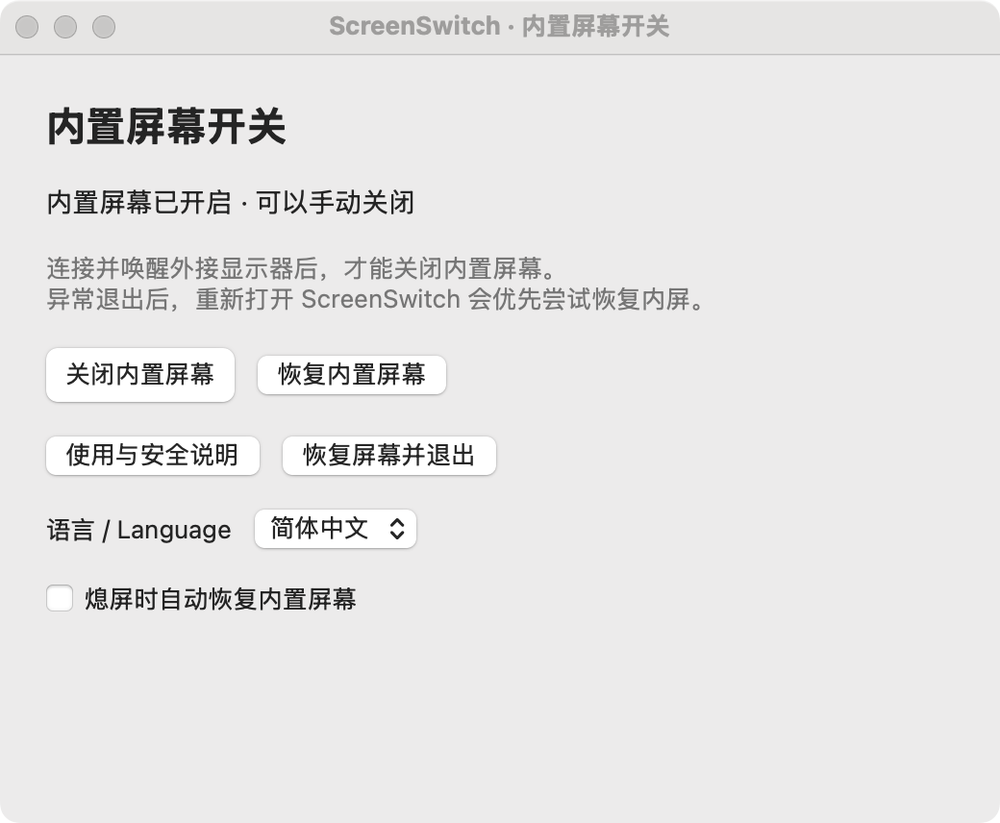

# ScreenSwitch · 内置屏幕开关

**简体中文** | [English](README.en.md)

让 MacBook 保持开盖，只用外接显示器工作，同时继续使用内置键盘和触摸板。

通过一个简单开关尝试真正停用内屏桌面输出，而不是把亮度调为零或盖上黑色窗口。提供控制窗口、Dock 和菜单栏入口，不怕菜单栏图标被刘海遮住。



*软件界面实拍：关屏与恢复合并在一个应用内，支持中英文切换。*

> **实验性工具：** 使用 macOS 未公开支持的接口，兼容性和恢复效果无法保证。目前只完成构建、界面和模拟检查，**尚未验证真实关屏与恢复效果**。首次使用前请了解下方恢复方法。

## 下载与安装

当前源码及本地构建为 **v0.2.0**，只需一个 **ScreenSwitch.app**，关屏和恢复功能已合并，无需另装恢复应用。按下方说明构建后，将 `dist/ScreenSwitch.app` 放入“应用程序”文件夹即可。

[Releases](https://github.com/haroldvandy2013/ScreenSwitch/releases/latest) 中现有的 **v0.1.0 是旧版双应用包**，尚不包含本次合并及语言切换功能。更新到单应用版并确认正常退出恢复后，可以删除旧的“恢复内置屏幕.app”。

需要 **macOS 13 或以上**，开发环境为 Apple Silicon M3 Max / macOS 15.8.1，但不代表已验证此机型关屏可靠。

应用未经 Apple 公证。如果系统阻止打开，可尝试右键选择“打开”，或在系统设置中选择“仍要打开”；**不要关闭系统安全保护**。

## 怎么用

1. 保持笔记本打开，接上并唤醒外接显示器，确认外屏能正常显示桌面。
2. 打开 ScreenSwitch，点击 **关闭内置屏幕**，阅读提示后确认。没有可用外屏时，此按钮不可用。
3. 需要内屏时，点击 **恢复内置屏幕**。

窗口底部或菜单中的 **语言 / Language** 可切换“简体中文”和“English”，立即生效并记住选择；首次打开默认中文。

**可选：熄屏时自动恢复内置屏幕。** 默认不勾选，只有开启后，显示器熄屏时才会自动尝试恢复被本软件关闭的内屏输出，并记住你的选择。这里指显示器熄屏，不是仅锁屏或显示屏保；不重启电脑，也不发送唤醒命令，实际亮屏行为取决于系统。唤醒后不会再次自动关闭内屏。

最后一个可用外屏断开时，程序会尝试自动恢复内屏；休眠和正常退出时也会尝试恢复。外屏重新连接或系统唤醒后，**不会自动关屏**。

上述系统休眠、拔线和退出时的安全恢复始终保留，不受熄屏选项影响。

关闭窗口不会退出程序。点击 Dock 图标或重新打开应用时，若内屏未启用或有待恢复记录，会先尝试恢复再显示窗口。退出请使用 **恢复屏幕并退出**，不要强制退出。

## 如果黑屏了

首次关屏前，先确认你能找到 ScreenSwitch；如果打算用 Spotlight 搜索，请先确认它已被索引。

1. 接回并唤醒外接显示器，尝试点击 **恢复内置屏幕**。
2. 重新打开 **ScreenSwitch.app**，程序会优先尝试恢复；也可通过 Spotlight 搜索“ScreenSwitch”打开。如果程序已卡死，重新打开可能无效，请继续下一步。
3. 尝试合盖再开盖。仍无法恢复时，重新启动 Mac，注意未保存的数据。

**崩溃、强制退出或系统故障时，自动恢复不能保证。** 首次使用建议直接连接实体外屏，不要把虚拟屏或远程桌面当作唯一保障，也不要同时运行其他关屏软件。若关屏或恢复失败，请停止继续尝试。

<details>
<summary>从源码构建</summary>

需要 Swift 6.0 或以上及 Xcode Command Line Tools。

```bash
git clone https://github.com/haroldvandy2013/ScreenSwitch.git
cd ScreenSwitch
./build.sh
```

只会生成 `dist/ScreenSwitch.app`，默认构建当前 Mac 的处理器架构。也可在终端运行 `./dist/ScreenSwitch.app/Contents/MacOS/ScreenSwitch --restore`，仅尝试恢复内屏，不关屏。

</details>
